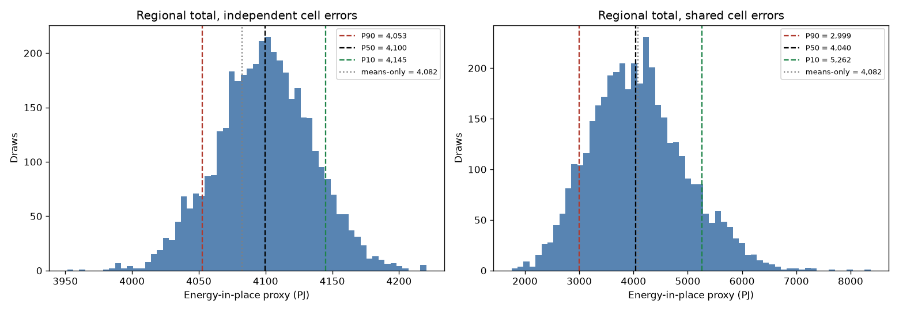

# Monte Carlo Uncertainty for a Gridded Resource Estimate

**Purpose.** Show how input uncertainty propagates into a regional total, and why the spatial error model changes the answer more than the number of draws does.

> **Synthetic data.** Every input is generated by `src/geothermal_mc/synthetic.py` with a fixed seed. The energy formula is an illustrative proxy. Nothing here is a real resource assessment.

## The problem

A regional estimate is a sum over grid cells. Each cell's inputs (thickness, porosity, temperature contrast) are uncertain and correlated with each other. A single deterministic total hides that uncertainty, so the output is reported as P90 / P50 / P10.

## Methods and tools

- **Correlated sampling:** Cholesky factor of the within-cell correlation matrix, applied to independent standard normals.
- **Two spatial error models:** `independent` (cell errors partly cancel) and `shared` (one error draw for all cells).
- **Percentile convention:** P90 is the low case, exceeded with 90% probability, and is the 10th percentile of the sample.
- **Checks:** GeoTIFF grid alignment (CRS, transform, shape) before use; a convergence check on draw count; a Spearman sensitivity measure.
- **Stack:** NumPy, SciPy, rasterio, Matplotlib, pytest.

## Preview



*Independent versus shared cell errors on the same inputs. The `figures/` images are generated by the notebook.*

## Key findings (from the executed notebook, synthetic data)

- With independent cell errors, P90 to P10 spans about 4,053 to 4,145 PJ (about ±1% around P50 = 4,100 PJ).
- With shared cell errors, the same inputs span 2,999 to 5,262 PJ (about −26% to +30% around P50).
- The means-only total is 4,082 PJ. The Monte Carlo mean is 4,089 to 4,099 PJ.
- P50 changes by less than 0.1% between 500 and 4,000 draws.
- All three inputs have similar Spearman sensitivities (about 0.58 to 0.66). The differences are within sampling noise.

## Repository structure

```
project-01-monte-carlo-uncertainty/
├── notebooks/monte_carlo_uncertainty.ipynb   # analysis, results, interpretation
├── src/geothermal_mc/
│   ├── synthetic.py    # synthetic GeoTIFF inputs (seeded)
│   ├── checks.py       # assert_aligned: CRS, transform, shape
│   └── sampling.py     # Cholesky sampling, bounds, resource proxy, summaries
├── tests/test_sampling.py   # 15 tests: correlation, bounds, units, alignment
├── figures/            # PNG outputs written by the notebook
├── data/               # generated on first run, not committed
├── pytest.ini
└── requirements.txt
```

## Installation

Python 3.10 or later.

```bash
python -m venv .venv
source .venv/bin/activate        # Windows: .venv\Scripts\activate
pip install -r requirements.txt
```

## Running

```bash
python -m pytest -q                       # run the tests
cd notebooks
jupyter nbconvert --to notebook --execute --inplace monte_carlo_uncertainty.ipynb
```

The notebook writes the synthetic rasters to `data/` and the figures to `figures/`.

**Windows note.** On a machine where `PROJ_LIB` or `GDAL_DATA` point at a different PROJ or GDAL install, rasterio fails with a PROJ database error. Unset those variables, or point them at the copies bundled with rasterio (`rasterio/proj_data` and `rasterio/gdal_data`). This was needed for the verification run recorded here.

## Data source and licence

No external data. The inputs are generated by code in this repository, released under the MIT licence of the portfolio.

## Limitations and next steps

- The inputs are synthetic and the energy formula is a proxy, so the numbers demonstrate method only.
- The correlation matrix is assumed, not estimated.
- Spatial correlation is absent. The two extremes bracket the answer, but real uncertainty is partly correlated over distance. An exponential covariance model would be the next step.
- Porosity means are clipped at 0.02 in some cells, which truncates the sampled distribution there.
- A one-at-a-time tornado analysis would separate the input effects more clearly than rank correlation.
