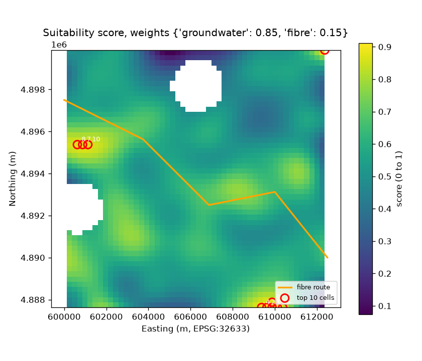

# Weighted-Overlay Site Ranking with Weight Sensitivity

**Purpose.** Rank candidate cells by two criteria, groundwater availability and proximity to fibre, and test how much the top of the ranking depends on the weights.

> **Synthetic data.** All layers are generated in code with fixed seeds. The 0.85 / 0.15 weights are an illustrative design choice, not an empirical result. Nothing here describes a real site.

## The problem

A weighted overlay turns several map layers into one score. The output is only as trustworthy as the inputs and the weights, and the weights are a judgement. The useful question is how much the ranking changes when they change, and whether the top of the list is stable.

## Methods and tools

- **Normalisation:** min-max scaling of each layer to [0, 1] over the valid cells. Distance is inverted, so closer to fibre scores higher. Distances are in metres, from cell centres in EPSG:32633.
- **Masking:** excluded cells are NaN in every layer and are never ranked. Smoothing runs before masking so NaN does not enter the filter.
- **Weighted sum** with validation: weights must be non-negative and sum to 1, and layer names and shapes must match.
- **Sensitivity:** sweep the groundwater weight from 0.5 to 1.0, rescaling the other weights proportionally. Compare each scenario with the base case using Spearman correlation over all valid cells and Jaccard overlap of the top-10 and top-25 sets.
- **Stack:** NumPy, SciPy (Gaussian filter and Spearman), Shapely (distance to route), pandas, Matplotlib, pytest.

## Preview



*Score under the base weights. Red circles mark the top 10 cells, numbered by rank. The orange line is the synthetic fibre route.*

## Key findings (from the executed notebook, synthetic data)

- **The top 10 cells form about two patches**, one on the western edge and one along the southern edge. Several are adjacent, so the list describes about two candidate areas rather than ten independent options.
- **The full ranking is more stable than the top of the list.** At a groundwater weight of 0.80 or 0.90, the Spearman correlation with the base ranking is 0.99. The top-10 overlap is only 0.67 at either value, and it falls to 0 at 0.50.
- **Top-25 overlap** is 0.85 at 0.80 and 0.92 at 0.90, so the top-25 set is more robust than the top-10 set.
- **Groundwater drives the top sites.** Groundwater accounts for about 90% of the top-10 score. Their mean distance to the fibre route is 3.3 km, against 2.7 km across valid cells, so fibre proximity slightly lowers their score.

## Repository structure

```
project-02-weighted-overlay/
├── notebooks/weighted_overlay_ranking.ipynb   # analysis, sensitivity, interpretation
├── src/site_overlay/
│   ├── grid.py       # Grid, cell centres, synthetic layers
│   ├── scoring.py    # min-max, proximity score, weighted overlay, weight validation
│   └── ranking.py    # top-k extraction, Jaccard overlap, weight sweep
├── tests/test_overlay.py   # 18 tests: normalisation, weights, NaN, ranking, sweep
├── figures/                # PNG outputs written by the notebook
├── pytest.ini
└── requirements.txt
```

## Installation

Python 3.10 or later.

```bash
python -m venv .venv
source .venv/bin/activate        # Windows: .venv\Scripts\activate
pip install -r requirements.txt
```

## Running

```bash
python -m pytest -q
cd notebooks
jupyter nbconvert --to notebook --execute --inplace weighted_overlay_ranking.ipynb
```

No input files are needed. The notebook generates every layer in memory and writes figures to `figures/`.

**Windows note.** If `PROJ_LIB` or `GDAL_DATA` point at a different PROJ or GDAL install, rasterio can fail with a PROJ database error. Unset them, or point them at the copies bundled with rasterio. This was needed for the verification run recorded here.

## Data source and licence

No external data. All layers are generated by code in this repository, released under the MIT licence of the portfolio.

## Limitations and next steps

- The layers are synthetic. The groundwater field has no physical basis, so the results show method, not a real site.
- Min-max normalisation depends on the study extent. Scores are comparable only within the same extent.
- The overlay is linear and compensating. Real site selection often needs thresholds or hard constraints, which are not modelled here.
- Smoothing uses `mode="nearest"`, so edge cells take boundary values. The edge patches may partly reflect this.
- Costs, land ownership, zoning and water rights are not included.
- Next steps: compare threshold and constraint layers with the min-max scale, add Dirichlet random-weight sensitivity, and report contiguous areas rather than single cells.
