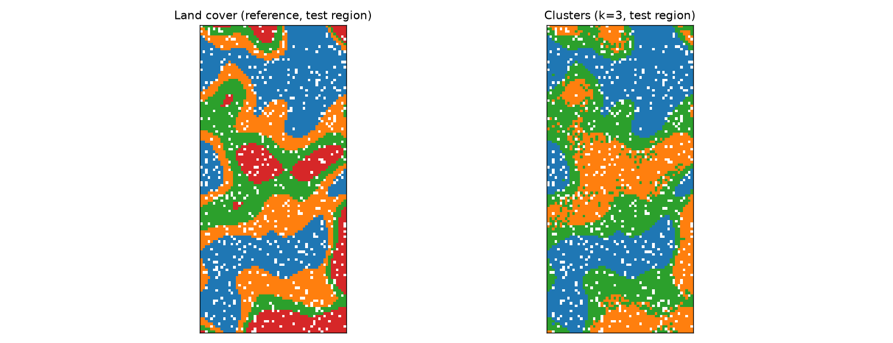

# Unsupervised Clustering of Multi-Band Vegetation Optical Depth

**Purpose.** Test whether an unsupervised pipeline can group pixels by their multi-band vegetation signature, and whether the groups match land cover, using a leakage-safe spatial split and a single-band baseline.

> **Synthetic data.** The scene is generated in code with a fixed seed. Band names are generic placeholders, and the class profiles are invented. Nothing here is a satellite observation or a validated VOD product, so the agreement reported below does not show performance on real data.

## The problem

Vegetation optical depth from passive microwave sensors depends on canopy structure and water content. The pattern of values across several frequency bands can carry information about vegetation type. Land-cover labels are often missing or out of date, so an unsupervised grouping can be a first look.

## Methods and tools

- **Harmonisation:** keep finite values within a physical range, reshape to one row per pixel, and work in log space. A common multiplicative moisture effect becomes additive in log space.
- **Leakage control:** the scaler and PCA are fitted on training pixels only. Land-cover labels are used only for evaluation. A column buffer separates the train and test regions.
- **Model:** standardise, then PCA (2 components), then k-means (`n_init=10`), in a scikit-learn pipeline.
- **Choice of k:** silhouette on training data, over k = 2 to 6. The true number of classes is not used.
- **Evaluation:** adjusted Rand index (ARI) against land cover on the held-out region, silhouette on test pixels, seed stability (ARI between two k-means seeds), and a single-band quantile baseline.
- **Stack:** NumPy, scikit-learn, Matplotlib, pytest.

## Preview



*Left: land-cover reference on the held-out region. Right: k-means clusters from the headline run. Cluster IDs are arbitrary, so colours do not match across panels. Read agreement from the crosstab in the notebook.*

## Key findings (from the executed notebook, synthetic data)

- **Headline result (k = 3, chosen by silhouette):** ARI 0.75 against land cover, versus 0.67 for a single-band baseline. Test silhouette is 0.63, against 0.56 for the baseline.
- **Seed stability:** ARI 0.999 between two k-means seeds.
- **Why k = 3:** silhouette prefers k = 3 (0.618) over k = 4 (0.581). At k = 3, cluster 0 is almost pure forest (2,270 of 2,273 pixels), and cropland (898) and grassland (798) are merged into cluster 1. This merge accounts for most of the gap to the diagnostic result.
- **Diagnostic at k = 4** (uses land cover to choose k, so not a valid result): ARI 0.84 for the clustering, against 0.50 for the baseline. The features separate all four classes well when k is right, and the shape across bands adds information beyond one band.

## Repository structure

```
project-03-vod-unsupervised/
├── notebooks/vod_unsupervised_clustering.ipynb   # analysis, evaluation, interpretation
├── src/vod_clustering/
│   ├── synthetic.py      # seeded synthetic multi-band scene and land cover
│   ├── preprocessing.py  # harmonise (range checks, log), spatial split with buffer
│   └── model.py          # pipeline, k selection, evaluation, baseline, seed stability
├── tests/test_clustering.py   # 9 tests: data generation, harmonisation, split, leakage, metrics
├── figures/                   # PNG outputs written by the notebook
├── pytest.ini
└── requirements.txt
```

## Installation

Python 3.10 or later.

```bash
python -m venv .venv
source .venv/bin/activate        # Windows: .venv\Scripts\activate
pip install -r requirements.txt
```

## Running

```bash
python -m pytest -q
cd notebooks
jupyter nbconvert --to notebook --execute --inplace vod_unsupervised_clustering.ipynb
```

No input files are needed. The notebook generates the scene in memory and writes figures to `figures/`.

## Data source and licence

No external data. The scene is generated by code in this repository, released under the MIT licence of the portfolio. Real VOD products and land-cover maps have their own licences and access terms, which would need to be verified before use. None is included here.

## Limitations and next steps

- The classes are separated by design, so high agreement is expected in this setting. It says nothing about performance on real observations.
- Real VOD has irregular gaps, seasonal and retrieval effects, and coarse footprints. These are not modelled.
- Moisture is one common amplitude factor. Real moisture responses differ across bands.
- There is one split from one scene with one seed. No confidence intervals are reported.
- Cluster-count selection is the main weakness: silhouette merges two classes. Stability across seeds and splits, or a Gaussian mixture with a likelihood criterion, would be the next things to try.
- Planned: spatial block evaluation, a sensitivity sweep over moisture effect, gap fraction and class separation, and a regional real-data run after licence checks.
