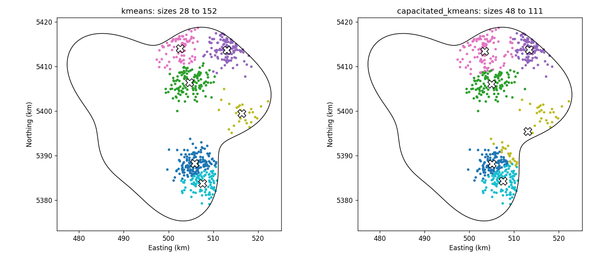

# Capacity-Constrained Spatial Clustering with a Network Cost Estimate

**Purpose.** Group facility locations into balanced service clusters, and estimate the cabling each cluster needs. Quantify what the balance constraint costs.

> **Synthetic data.** The study area, the facility points and the hotspot densities are generated with a fixed seed. Nothing here reflects a real region, real facilities or real network infrastructure.

## The problem

Ordinary k-means places centres where points are dense, so clusters can be very uneven. An uneven cluster may be cheap in total distance but expensive to serve. A balanced partition can cost more. The useful question is how much a balance constraint costs in cabling, and what else it changes.

## Methods and tools

- **Capacitated k-means:** Lloyd iterations where the assignment step is an exact min-cost assignment with a per-cluster capacity. It uses the Hungarian algorithm (`scipy.optimize.linear_sum_assignment`) over repeated centre slots, so no cluster exceeds its capacity at any iteration.
- **Network cost:** minimum spanning tree (MST) length of the points in each cluster, an approximation of the shortest cable needed to link them.
- **Cohesion:** largest cluster diameter, and silhouette score for reference.
- **Input validation:** a valid polygon in metres, every point inside the area, no duplicates or non-finite coordinates.
- **Stack:** NumPy, SciPy, scikit-learn, Shapely, pandas, Matplotlib, pytest.

## Preview



*Same 600 synthetic points, six clusters. Crosses mark the centres. Balancing moves the boundary points of the yellow cluster into its neighbours.*

## Key findings (from the executed notebook, synthetic data)

- **Balance is cheap in cable.** On the main layout, total MST cable rises from 318 km to 329 km (+3.7%). Across five layouts the increase averages 4.3%, ranging from 2.1% to 8.3%.
- **Balance is expensive in spread.** The largest diameter rises from 12.3 km to 19.3 km on the main layout. Across layouts the average rise is 35%, with a wide spread.
- **The slack is a usable dial.** Total cable changes by about 6% across the full slack range, while the diameter changes by more than twice that. The diameter is the more sensitive measure when choosing a slack.
- **Silhouette falls with balance** (0.48 to 0.41 on the main layout), which reflects the points that are moved away from their nearest centre.

## Repository structure

```
project-04-constrained-spatial-clustering/
├── notebooks/capacitated_spatial_clustering.ipynb   # analysis, sweep, interpretation
├── src/spatial_clusters/
│   ├── synthetic.py    # study area polygon and hotspot-based facility points
│   ├── geometry.py     # validation of the polygon and the points
│   └── clustering.py   # capacity assignment, capacitated k-means, MST and diameter
├── tests/test_clustering.py   # 12 tests: capacity, feasibility, MST, diameter, validation
├── figures/                   # PNG outputs written by the notebook
├── pytest.ini
└── requirements.txt
```

## Installation

Python 3.10 or later.

```bash
python -m venv .venv
source .venv/bin/activate        # Windows: .venv\Scripts\activate
pip install -r requirements.txt
```

## Running

```bash
python -m pytest -q
cd notebooks
jupyter nbconvert --to notebook --execute --inplace capacitated_spatial_clustering.ipynb
```

No input files are needed. The notebook generates every input in memory and writes figures to `figures/`.

## Data source and licence

No external data. All inputs are generated by code in this repository, released under the MIT licence of the portfolio.

## Limitations and next steps

- The points come from six strong hotspots by design. Real facility distributions may be less clustered, and the trade-off would change.
- The MST is a proxy for cabling. Real networks follow roads or rights of way, and terrain and route costs are not modelled.
- Capacitated k-means is a local search. Its result depends on the starting centres and is not guaranteed to be globally optimal.
- The capacity is an equal share plus slack. Real constraints may be demand weights, travel time or maximum distance.
- Only one run per layout was made for each method, so seed-to-seed variation within a layout is not measured.
- Next steps: demand-weighted capacities, a routed network on a road graph in place of the MST, a maximum-diameter constraint, and more layouts with confidence intervals.
